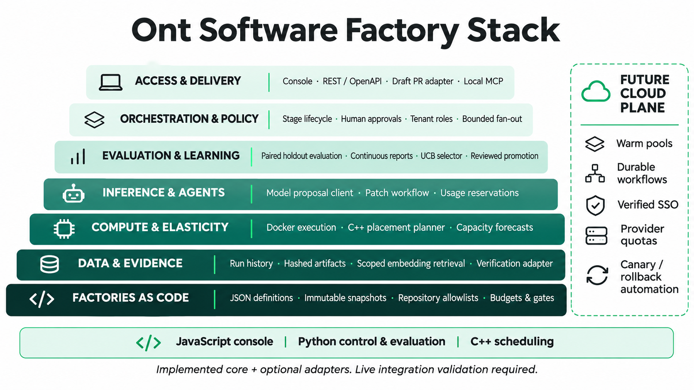

# Ont · Software Factory

**Turn engineering intent into reviewable, verified software delivery.**

[](https://github.com/bijit-ghosh/Ont/actions/workflows/ci.yml)
[](LICENSE)

[Quickstart](#quickstart) · [Architecture](docs/FACTORY_STACK.md) · [Packages](docs/PACKAGING.md) · [Client walkthrough](docs/PRESENTATION.md) · [Validation](docs/CLIENT_RELEASE.md) · [Documentation](docs/README.md)



## About

Ont is a software factory for turning engineering intent into reviewable software changes. It coordinates coding agents, repository work, verification evidence, human approvals, and delivery through one configurable control plane.

Built for teams that want to own their development workflow, Ont supports model and harness choice, self-hosted operation, and an inspectable record of each stage. Its goal is to make agent-assisted delivery faster to operate, easier to review, and measurable enough to improve.

The current release includes the operator console, persistent workflows, evaluation tools, a native scheduling planner, and optional integration adapters. Live code generation and deployment require configured providers and execution infrastructure; the demo identifies simulated work explicitly.

Created and maintained by **Bijit Ghosh** under the MIT license.

## Mission

Make agent-assisted software delivery dependable: every change should have a clear purpose, accountable cost, inspectable evidence, and an appropriate approval path. Improve the factory through measured outcomes and reviewed changes to its own configuration.

## Start with your goal

| Goal | Entry point |
| --- | --- |
| Present the workflow without external credentials | `ont demo` and the [meeting guide](docs/PRESENTATION.md) |
| Run your team's control plane | `ont serve` and [configuration](docs/CONFIGURATION.md) |
| Connect a coding model and repository | [Integration setup](docs/INTEGRATIONS.md) and [worker protocol](docs/WORKER.md) |
| Understand the stack and execution boundaries | [Factory stack](docs/FACTORY_STACK.md) and [system design](docs/SYSTEM_DESIGN.md) |
| Evaluate improvements before promotion | [Improvement guide](docs/IMPROVEMENT.md) |
| Package or deploy Ont | [Packaging](docs/PACKAGING.md) and [operations](docs/OPERATIONS.md) |

## Quickstart

Python 3.12+, Git, and access to the Python package index are required. From Bash:

```bash
git clone https://github.com/bijit-ghosh/Ont.git
cd Ont
python -m venv .venv
. .venv/bin/activate
python -m pip install -r requirements.lock.txt
python -m pip install --no-deps .
ont demo
```

On Windows PowerShell, replace the activation command with `.\.venv\Scripts\Activate.ps1`.

Open `http://127.0.0.1:3000` on the machine running Ont. The demo uses its own database and includes queued work, approval checkpoints, and completed illustrative runs. It does not call a model or alter a repository. Existing presentation databases are preserved; use `ont demo --db data/another-demo.sqlite3` for a fresh workspace.

For an empty operational workspace, run `ont serve`. Source-checkout commands such as `python -m scripts.presentation` remain supported. Tokens are optional only for loopback development; configure production credentials before remote use.

## What you can use today

| Capability | Behavior |
| --- | --- |
| Operator console | Work orders, approvals, activity, artifacts, configuration, stack view and metrics |
| Workflow control | Triage, spec, build, review and verify; explicit gates, cancellation and stale-lease rejection |
| Durable records | SQLite persistence, configuration snapshots, artifact hashes, export and consistent backups |
| Execution interfaces | Worker claims/heartbeats/results; optional immutable checkout, patch and container-verification adapters |
| Delivery adapters | Explicit draft-PR publication and allowlisted Kubernetes rollout/undo |
| Access boundaries | Optional tenant database gateway with reader, admin and worker roles |
| Context | Tenant-scoped embedding retrieval supplied with caller-generated vectors |
| Improvement | Paired holdout evaluation, continuous dataset reports and a UCB policy-selection primitive |
| Native planning | C++20 resource-fit selection and bounded capacity recommendations |
| Local agent tooling | Minimal stdio MCP discovery/capability tool and PKCE transaction helpers |

The default server is one workspace. Tenant routing is a separate entry point. Adapter contract tests are not live-service qualification. [Readiness](docs/READINESS.md) describes the exact boundaries, including SSO, provider quotas, browser validation and cloud execution work still required.

## Architecture

Ont uses **JavaScript** for the browser, **Python** for control and evaluation, and **C++20** for local scheduling decisions. The stack separates factory definitions, data/evidence, compute, inference, evaluation, orchestration/policy, and access/delivery.

- [Layered factory stack](docs/FACTORY_STACK.md)
- [Module architecture map](docs/ARCHITECTURE_MAP.md)
- [Service contracts and rollout stages](docs/SYSTEM_DESIGN.md)
- [Latency and elasticity boundaries](docs/PERFORMANCE.md)

The planner's local microbenchmark does not measure sandbox provisioning. Optional adapters are not an automatically connected autonomous cloud service.

## Docker deployment

Set distinct random `ONT_ADMIN_TOKEN` and `ONT_WORKER_TOKEN` values of at least 32 characters, plus comma-separated `ONT_ALLOWED_HOSTS` containing your actual hostnames. Then run:

```bash
docker compose up --build -d
```

The recipe binds to loopback and retains data in a named volume. Remote access requires TLS ingress and appropriate authorization. See [configuration](docs/CONFIGURATION.md) and [operations](docs/OPERATIONS.md) for setup, health, backup and recovery. Keep the worker's execution privileges separate from the control plane.

## Validate a release

Full validation requires Node.js 24, a C++20 compiler with sanitizer support, Python dependencies, and Git. Docker is additionally required for the container smoke test.

```bash
python scripts/validate.py --cycles 3
docker build -t ont-control-plane:validated .
python scripts/container_smoke.py ont-control-plane:validated
```

The CI badge links to Ont's own release checks: Python tests, frontend logic/render checks, native checks/sanitizers, a container build, and full demo HTTP/restart smoke. Reports are retained as workflow artifacts. The project-refinement gate contains 51 Python tests per cycle; use the matching CI result for the source commit being deployed. See [validation evidence](docs/VALIDATION.md).

## Packaging and repository map

Installable wheel and source-distribution recipes are now included. They are built from this repository; no public PyPI or npm publication is claimed. The wheel carries the Python runtime, `ont` CLI, and browser assets. Native C++ source and developer checks are part of the source distribution/repository, not a precompiled wheel binary.

```text
ont/                  Control plane, CLI, presentation, evaluation and integration adapters
web/                  Browser console source
native/scheduler/     C++20 placement and capacity planner
tests/                Workflow, tenant, adapter, presentation and frontend regression tests
scripts/              Validation, packaging, backup, diagrams and container checks
examples/             Factory configuration example
docs/                 Architecture, setup, integration, operation and validation guides
.github/              Release checks and dependency-update configuration
```

See [packaging](docs/PACKAGING.md), [contributing](CONTRIBUTING.md), [security](SECURITY.md), and the [roadmap](docs/ROADMAP.md).

## License

[MIT License](LICENSE). Copyright (c) 2026 Bijit Ghosh.
