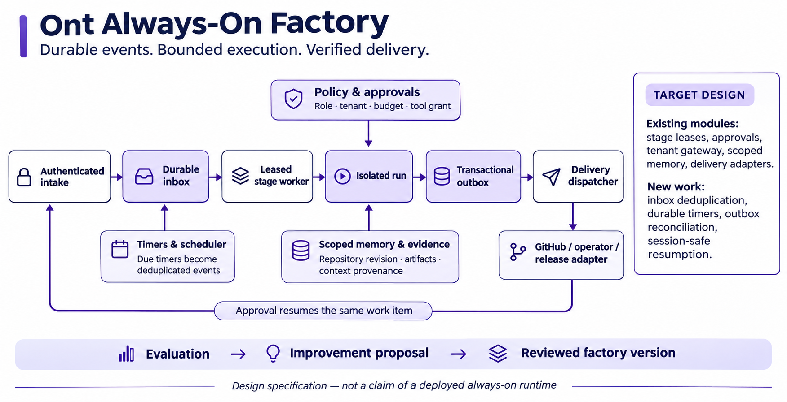

# Ont always-on factory architecture

This is the target event-driven runtime design for Ont. It complements the seven-layer stack; it does not replace it. Stage leases, approval gates, tenant routing, memory and delivery adapters already exist. A durable deduplicated inbox, timer dispatcher, transactional outbox, and session-safe event resumption are proposed work, not deployed capabilities.

## Five runtime primitives

| Primitive | Ont responsibility | Existing foundation | Required addition |
| --- | --- | --- | --- |
| Event inbox | Accept issue changes, user requests, verification results, and approval decisions | REST work orders and lifecycle events | Authenticated source adapters; unique source-event keys; durable event states and session coalescing |
| Timers | Wake verification follow-ups, maintenance, and evaluation jobs | External invocation of scripts and continuous evaluation watcher | Durable due-time records, atomic conversion into inbox events, cancellation and missed-timer policy |
| Memory and evidence | Resume with scoped context and exact artifacts | Run/configuration snapshots, hashed text artifacts, embedding retrieval | Versioned session checkpoint, provenance/retention policy, access-filtered retrieval, artifact manifests |
| Permissions | Authorize each tool action while work is unattended | Tenant-role gateway, repository allowlists, stage approvals, budget ledger | Per-action grants, expiry, verified actor identity, deferred-action records, independent verifier identity |
| Outbox | Deliver draft PRs, results, questions, and release requests | Explicit delivery and release adapters | Transactional delivery intents, leased dispatch, destination idempotency and reconciliation |

## Layer-by-layer alignment

### Factories as code

Extend the factory schema with source filters, timer policies, session key rules, allowed tools, approval policy, output destinations, retry ceilings, retention, and spend limits. Validate and snapshot the full definition before execution. Never let incoming event text change those grants.

### Data and evidence

Add tenant-scoped inbox, timer, checkpoint, permission-decision, and outbox records. Preserve event provenance, factory version, source commit, and causation IDs. Keep canonical run state in transactional storage; do not substitute model memory for workflow state. Reuse current SQLite only for the single-workspace deployment; use PostgreSQL for distributed coordination.

### Compute and elasticity

Workers claim durable stage leases, restore an authorized checkpoint, and execute one bounded segment. Warm pools can reduce startup delay; the native planner remains advisory until a broker atomically reserves slots. Checkpoints contain artifacts and replayable tool receipts, not an assumption that a model session or container survives indefinitely.

### Inference and agents

Resume a model with a bounded context package derived from the current checkpoint and permitted memory. Model output proposes actions. A trusted policy boundary decides whether to execute, defer for review, or reject. Record tool calls, usage, model version, and harness version; reconcile actual cost even on failure.

### Evaluation and learning

Evaluate delivered outcomes and failed attempts, including retries, human interventions, cost, and delayed regressions. Retain the implemented paired evaluation/reporting loop. Candidate policies must use a frozen dataset and reviewed promotion; neither successful inbox processing nor an agent's own success claim is an independent quality label.

### Orchestration and policy

Wake work from inbox events rather than keeping model calls active. Serialize state transitions per tenant/session. Coalesce only compatible events sharing source revision and policy context. Approval resumes the same deferred action with an expected checkpoint revision; stale or differently scoped approval fails closed. Retries are bounded and apply only to known-idempotent operations.

### Access and delivery

Keep ingress handlers short: authenticate source, validate payload, persist event, acknowledge. The dispatcher delivers only approved outbox intents. It must reconcile ambiguous external responses before retrying PR creation or release actions. Operator answers return through authenticated intake with the original action/session correlation.

## Proposed record contracts

| Record | Minimum fields and invariant |
| --- | --- |
| Inbox event | tenant, source, source_event_id, session_id, payload_hash, payload_reference, source_revision, state, lease, attempts, next_attempt_at; unique `(tenant, source, source_event_id)`; conflicting duplicate hashes rejected |
| Timer | tenant, timer_id, factory_version, session_id, due_at_utc, recurrence_policy, cancellation_revision; unique occurrence key; one occurrence becomes one inbox event |
| Checkpoint | tenant, session_id, revision, factory_version, source_commit, artifact_manifest, deferred_action_id; revision-checked writes |
| Tool decision | tenant, action_id, actor, grant_version, parameters_hash, verdict, expires_at; approval binds to exact action/parameters/checkpoint |
| Outbox intent | tenant, destination, action_key, payload_hash, payload_reference, state, lease, attempts, receipt; unique destination action key; intent written with state transition |

Use at-least-once delivery with idempotency and reconciliation. Do not promise exactly-once external side effects. A sent request with a lost response is an ambiguous outcome, not a license to send again blindly.

## Failure and security behavior

- Duplicate events produce no duplicate run; payload conflicts produce a visible rejection.
- A crash after state commit preserves outbox intent; a crash after remote success requires receipt reconciliation.
- Expired worker leases reject late results; resume work only after checking external effects.
- A missed timer follows declared catch-up/skip policy with bounded backlog; all storage timestamps use UTC.
- Revoked grants and expired approvals block resumed actions. Re-authorize at execution, not just at intake.
- Tenant/session keys come from trusted mappings, never from untrusted prompt text.
- Retries exhaust into a visible dead-letter state with operator recovery; they do not loop without a ceiling.
- Outbox destinations and credential scopes are allowlisted. Keep secrets outside model context and sandbox state.

## Incremental delivery and validation

1. **Inbox:** add schema and authenticated intake; test duplicate/conflicting event handling, tenant separation, concurrent claims, crash recovery, and source-signature rejection.
2. **Timers:** implement atomic due-occurrence enqueueing; test scheduler races, cancellation, clock boundaries, catch-up policy, and restart behavior.
3. **Checkpoint and permissions:** persist deferred actions; test stale approval, revoked grants, modified action parameters, cross-tenant resume, and lease expiry.
4. **Outbox:** record intent with workflow transition; test duplicate delivery, remote timeout after success, dead-letter handling, dispatch leases, and reconciliation.
5. **Elastic broker:** connect native planning to ready inventory and atomic leases; validate pool exhaustion, no busy-slot eviction, quota enforcement, reset isolation, and forecast error.
6. **Outcome feedback:** link remote receipts and verification to run outcomes; evaluate on real held-out tasks before promoting policies.

These are future implementation acceptance criteria. Existing tests do not count as completed validation for these new primitives. No recurring deployment job or automation is scheduled by this architecture update.

## Connection to the current project

See [FACTORY_STACK.md](FACTORY_STACK.md) for the layered view, [SYSTEM_DESIGN.md](SYSTEM_DESIGN.md) for service boundaries, [INTEGRATIONS.md](INTEGRATIONS.md) for adapter activation, and [VALIDATION.md](VALIDATION.md) for measured evidence. The supplied reference informed the five-primitives design pattern; the Ont contracts and layer mapping above are project-specific.
