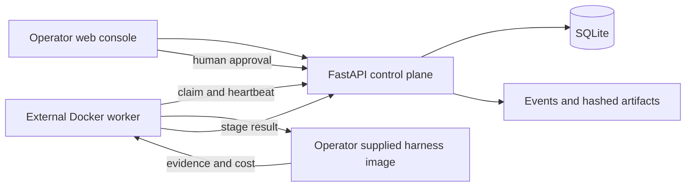

# Ont implementation and target software stack

See the [Ont Software Factory Stack](FACTORY_STACK.md) for the layered project view and implementation boundaries.

## Product boundary

A software factory turns an authorized engineering request into a reviewed, verified change. Completion in Ont v0.1 means an external worker reported verification evidence; it does not mean a change was merged, deployed, or independently proven correct.

## Platform model

Ont connects five core capabilities: factories as code, data and context, sandboxed compute, swappable inference, and orchestration through APIs. Evaluation forms a feedback loop across these capabilities. The access surface includes the console, REST/OpenAPI, and planned MCP and engineering-tool integrations.

A production factory definition must declare agent workflows, policies, and triggers alongside repository, model, execution, and approval settings. Full activity capture includes conversations, tool calls, artifacts, screenshots, and video, with provenance and retention controls. These are target capabilities; the implementation status below identifies the current release boundary.

## Implemented architecture

The backend never executes task descriptions or artifact text. State changes occur in SQLite transactions. A single worker holds a five-minute lease per active stage; a lease heartbeat extends it. Recovery of expired work is explicit to avoid silent duplicate side effects. Result submission checks the active lease and cancellation state. A completed stage requires an artifact; final verification additionally requires a structured receipt. Configuration is copied into each run at creation, so later edits do not alter an in-flight run.

Two separate shared bearer tokens distinguish operator and worker access. This is single-tenant access control, not production identity management. Hashes detect content differences but do not make the database tamper-proof. Costs are worker reports, not provider invoices; API rejection of over-budget results cannot undo provider charges. Real adapters must enforce provider budgets before calls and reconcile actual cost after failures.

## Production stack recommendation

These are architectural choices to validate, not dependencies already integrated into this MVP. Pin supported versions and review licenses/advisories at implementation time.

| Layer | MVP | Target stack and responsibility |
| --- | --- | --- |
| Access | HTML/CSS/JS console; REST/OpenAPI | TypeScript/React console, CLI/SDK, MCP gateway, GitHub App and Slack/Linear adapters; OpenAPI as the stable contract |
| Orchestration | Transactional state machine | Temporal durable workflows; task DAGs, child workflows, timeouts, idempotency keys, compensating actions, manual checkpoints |
| Improvement | Outcome metrics and artifact export | Reproducible evaluation workers, held-out benchmark registry, experiment store, paired comparisons, reviewable configuration PRs |
| Inference | External harness contract | Provider adapter gateway with typed tool interfaces, quotas, circuit breakers, model policy, normalized usage, evaluation-backed routing |
| Compute | Restricted reference Docker worker | Kubernetes job pool with gVisor or microVM isolation, ephemeral volumes, per-job identities, egress allowlists, image provenance, CPU/memory/time limits |
| Data & context | SQLite text records | PostgreSQL for metadata, pgvector for attributed/versioned retrieval, S3-compatible storage for patches/logs/recordings, immutable evidence manifests |
| Factories as code | Validated JSON + run snapshots | JSON Schema and YAML compiler, signed/versioned definitions in Git, policy checks, dry runs, promotion and rollback |
| Cross-cutting | Shared tokens and event trail | OIDC/SSO, role and tenant enforcement, OpenTelemetry, metrics/alerts, secrets manager, audit export, retention and deletion policies |

Redis can serve caching/rate limiting if needed; it should not be the sole durable record of workflow state. Use managed PostgreSQL and object storage before introducing a large service fleet. Keep the control plane, execution plane, and inference gateway separate so agent tools never inherit operator credentials.

## Core production records

- Workspace, membership, role, repository installation, and connector grant.
- Factory and immutable factory version, with validated stage graph and policy.
- Work order, acceptance criteria, run, attempt, stage execution, and lease.
- Artifact manifest: run/stage identity, source commit, content hash, storage URI, producer, and timestamp.
- Approval: actor identity, exact artifact/version approved, reason, and decision time.
- Model invocation: provider/model version, input/output token usage, reservation, actual cost, and outcome.
- Evaluation dataset version, experiment, score, and confidence estimate.
- Release, deployment receipt, rollback link, and post-release observation.
- Context entry: source, owner, access policy, revision, expiration, and supersession link.

## Execution path

1. Verify webhook signatures and deduplicate incoming event IDs. Normalize the request and its authorization context.
2. Snapshot the repository commit, factory version, permissions, budget reservation, and acceptance criteria.
3. Triage and specify; request human review when policy requires it.
4. Launch isolated agent work against an immutable starting checkout. Treat repository text and retrieved documents as untrusted input.
5. Save the patch and evidence, then run an independent review/verification identity against the exact patch commit.
6. Create a draft PR through the GitHub App with narrowly scoped permission. Respect branch protection; never infer merge authority from workflow approval.
7. Track release/deployment only after separate authorization. Capture health checks and retain a rollback route.
8. Reconcile billed cost and observe regressions. Proposed factory improvements must pass evaluation before human-reviewed promotion.

## Priority roadmap and acceptance gates

### Phase 1 — Real repository delivery

Add GitHub App installation, repository allowlists, immutable checkout provisioning, one supported coding-agent adapter, dependency caching, exact-commit test verification, patch storage, and draft PR creation. Gate: a real task reaches a reviewable PR with reproducible evidence; duplicate delivery cannot create duplicate PRs. The owner supplies provider credentials and selects repositories before live execution.

### Phase 2 — Durable execution and identity

Migrate to PostgreSQL/object storage, introduce durable workflow execution, per-user approvals, OIDC roles, tenant isolation, and job identity. Add budget reservations and provider usage reconciliation. Gate: restart and cancellation fault tests pass; a cross-tenant access test suite finds no leaks; backup restore is demonstrated.

### Phase 3 — Measured orchestration

Add parallel specialist workers, context retrieval with provenance, model adapters, paired benchmark runs, and a configuration experiment registry. Gate: measurable improvement on held-out tasks with no increase in escaped defects, including failure/retry costs.

### Phase 4 — Controlled release and improvement

Add environment-specific promotion policy, canary delivery, runtime feedback, rollback, and evaluation-gated improvement PRs. Gate: a deliberately failing release rolls back, and improvements cannot self-promote around policy or independent verification.

## Operational limits

The MVP uses SQLite with serialized writes and is intended for one workspace, not a multi-region fleet. Text artifacts are bounded per request, but aggregate quotas, pagination, retention jobs, and large-file storage are still needed. There is no scheduler, billing service, independent evidence verifier, or automatic incident recovery. Public exposure requires hardened ingress, authenticated users, rate limits, observability, backups, and security review.

## Detailed contracts

See [SYSTEM_DESIGN.md](SYSTEM_DESIGN.md) for plane ownership, transactional delivery, evidence schemas, rollout phases, and proposed service objectives. See [IMPROVEMENT.md](IMPROVEMENT.md) for the implemented offline evaluator and continuous loop.

## Rendered map and reference decisions

[ARCHITECTURE_MAP.md](ARCHITECTURE_MAP.md) maps code modules and boundaries to validation evidence. Regenerate its SVG with `python scripts/render_architecture.py`.

## Always-on execution design

[ALWAYS_ON.md](ALWAYS_ON.md) maps durable inbox events, timers, scoped checkpoints, action permissions, and outbox delivery onto each stack layer, with incremental acceptance tests and explicit implementation boundaries.
