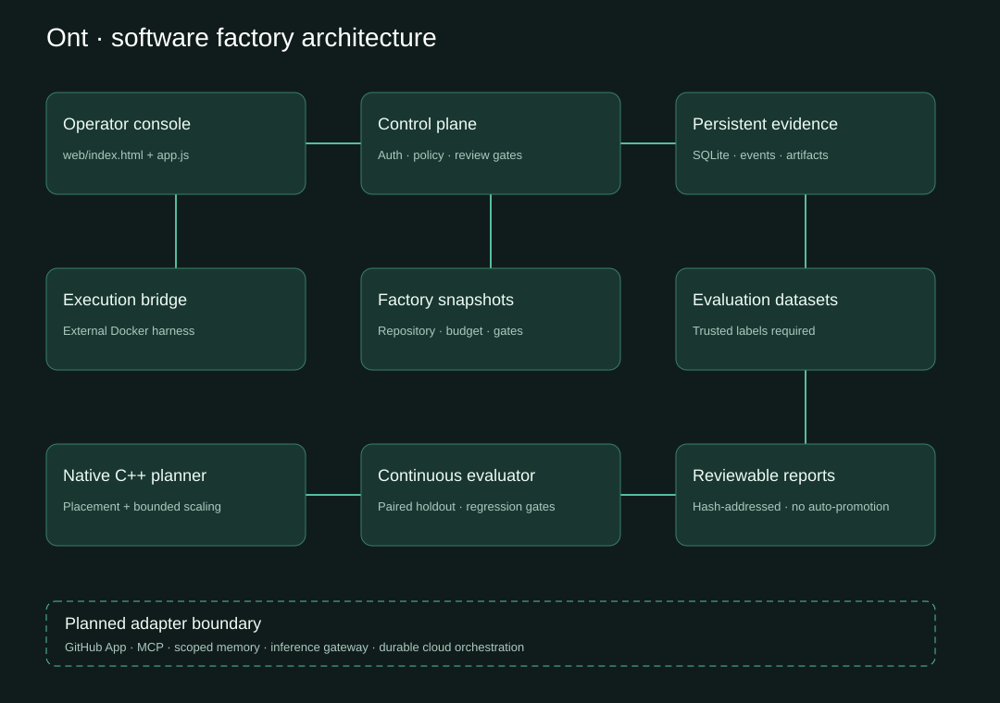
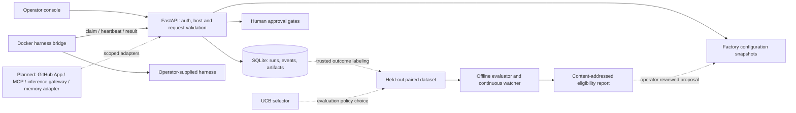

# Ont architecture map

Solid boxes name implemented modules. Dashed boxes name planned adapters or cloud services. Arrows are data/control contracts, not evidence that a planned integration is installed.

## Reference-informed decisions

[CyberOps](https://github.com/bijit-ghosh/CyberOps) demonstrates revision-bound evidence and deterministic release gates. Ont adopts the architectural principle that verification must bind to a specific change and that missing evidence cannot become success. A dedicated signed release-receipt service remains planned.

[CortexState](https://github.com/bijit-ghosh/CortexState) demonstrates scoped context, provenance, revision checks, and reviewed lesson promotion. Ont uses immutable factory snapshots and evaluation reports today. A scoped context adapter should carry workspace/repository/run identity, expiry, source revision, and permission checks; it is not bundled in this release.

These are independent reference projects. Ont's implementation remains MIT-licensed; no source was copied or vendor dependency added. The repository search found CortexState, not a repository named Cortex X.

## Implementation map

| Capability | Module | Validation |
| --- | --- | --- |
| Control plane and admission | `ont/app.py` | API, authorization, production-boundary tests |
| Execution bridge | `ont/worker.py` | Protocol tests cover server lifecycle; actual external harness needs integration testing |
| Learning primitives | `ont/improvement.py` | Paired-evaluation and bandit regression tests |
| Continuous evaluation | `scripts/improve_loop.py` | Idempotent scan/report test |
| Backup/recovery | `scripts/backup.py` | Concurrent write fixture and restored integrity/count |
| Release gate | `scripts/validate.py` | Three complete test cycles and syntax checks |
| Deployment recipe | `Dockerfile`, `compose.yaml` | Historical build passed; current rebuild is a separate check |

See [system design](SYSTEM_DESIGN.md) for durable cloud boundaries and [operations](OPERATIONS.md) for deployment prerequisites.
