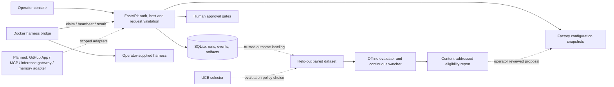

# Ont architecture map

See the [Ont Software Factory Stack](FACTORY_STACK.md) for the layered project view and implementation boundaries.

Solid boxes name implemented modules. Dashed boxes name planned adapters or cloud services. Arrows are data/control contracts, not evidence that a planned integration is installed.

## Implementation map

| Capability | Module | Validation |
| --- | --- | --- |
| Control plane and admission | `ont/app.py` | API, authorization, production-boundary tests |
| Execution bridge | `ont/worker.py` | Protocol tests cover server lifecycle; actual external harness needs integration testing |
| Learning primitives | `ont/improvement.py` | Paired-evaluation and bandit regression tests |
| Continuous evaluation | `scripts/improve_loop.py` | Idempotent scan/report test |
| Backup/recovery | `scripts/backup.py` | Concurrent write fixture and restored integrity/count |
| Release gate | `scripts/validate.py` | Three complete test cycles and syntax checks |
| Deployment recipe | `Dockerfile`, `compose.yaml` | CI image build and HTTP/restart smoke tests |

See [system design](SYSTEM_DESIGN.md) for durable cloud boundaries and [operations](OPERATIONS.md) for deployment prerequisites.

## Native execution planning

`native/scheduler/` adds a C++20 placement/capacity library and CLI alongside the JavaScript frontend and Python control/evaluation services. The rendered map names this component; its future connection to sandbox provisioning remains an adapter boundary. See [performance and elasticity](PERFORMANCE.md).
