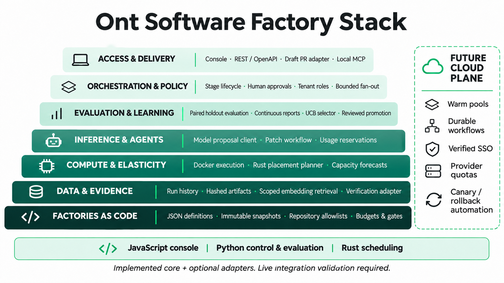

# Ont Software Factory Stack

Ont organizes its software factory into seven layers. The diagram combines the implemented core with optional adapters; the outlined cloud plane identifies future infrastructure. The integration guide defines configuration requirements for each adapter.

| Layer | Current project responsibility | Implementation boundary |
| --- | --- | --- |
| Access & delivery | JavaScript console, REST/OpenAPI, draft-PR adapter, local MCP discovery | MCP currently exposes a read-only capability tool; PR delivery requires trusted GitHub credentials and explicit wiring. |
| Orchestration & policy | Stage lifecycle, human approvals, tenant-role gateway, bounded fan-out | Tenant routing uses separate database files. Parallel execution is local, not a durable distributed scheduler. |
| Evaluation & learning | Paired held-out evaluation, continuous reports, UCB selector, review proposals | Reports establish eligibility for review; production promotion is not automated. |
| Inference & agents | Allowlisted model proposal client, patch workflow, usage reservations | A configured provider and trusted worker adapter are required. Local reservations do not enforce provider-side spending limits. |
| Compute & elasticity | Docker execution/verification, native Rust placement, capacity recommendations | The native planner is advisory; it is not connected to warm-pool provisioning or an elastic cloud controller. |
| Data & evidence | Run history, hashed artifacts, scoped embedding retrieval, verification adapter | Text hashes are not signatures. Independent verifier receipts are not yet enforced by the workflow server. |
| Factories as code | Validated JSON definitions, immutable snapshots, repository allowlists, budgets and gates | Current definitions support the existing stage lifecycle; arbitrary declarative DAGs and triggers remain future work. |

## Cross-cutting concerns

JavaScript implements the operator console. Python implements control-plane workflows, integration adapters, and evaluation. Rust handles local placement and scaling decisions. Permissions, evidence provenance, usage accounting, and observability apply across layers.

## Future cloud plane

Warm pools, durable workflows, verified SSO, provider-enforced quotas, and controlled canary/rollback automation remain deployment and integration work. A Kubernetes rollout/undo adapter exists, but a coordinated canary controller and automated policy promotion do not. The roadmap in [SYSTEM_DESIGN.md](SYSTEM_DESIGN.md) sets the service boundaries; [INTEGRATIONS.md](INTEGRATIONS.md) gives exact setup and qualification requirements.

## How work moves through the layers

An authenticated request creates a work order and snapshots factory policy. A worker claims a stage, prepares an authorized checkout, and invokes a configured harness. Stage results return artifacts and usage evidence. Human gates control progression. Separately configured verification and delivery adapters can test an exact commit and publish a draft PR. Evaluation consumes trusted outcome datasets to produce reviewable improvement reports.

This sequence is the intended connected path. The repository supplies the control plane and individual adapters; live end-to-end operation still requires wiring and qualification.

## Diagram assets

The stack graphic is `docs/assets/ont-factory-stack.png`. The module map remains in [ARCHITECTURE_MAP.md](ARCHITECTURE_MAP.md). This document is the textual source of truth for the layered view; update its implementation boundaries when capabilities change.
