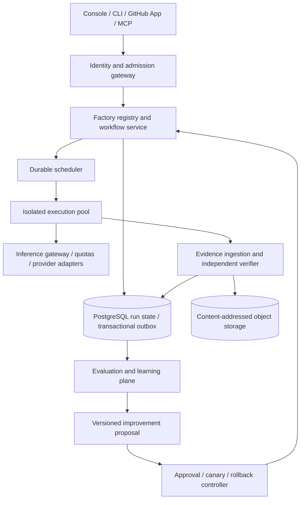

# Ont concrete system design

See the [Ont Software Factory Stack](FACTORY_STACK.md) for the layered project view and implementation boundaries.

## Planes and ownership

This diagram is the production target. The implemented deployment combines gateway, registry, workflow state, and text evidence in FastAPI/SQLite. It includes a Docker worker contract and offline evaluation/learning modules. PostgreSQL, durable scheduling, object storage, inference adapters, MCP, GitHub App delivery, and canary controllers are not yet installed components.

## Contracts

| Boundary | Input | Output | Invariant |
| --- | --- | --- | --- |
| Intake → admission | Source event ID, actor, repository, requested outcome | Authorized work order and idempotency record | Source identity cannot grant execution privileges |
| Registry → workflow | Factory version hash, source commit, policy | Immutable run snapshot | In-flight runs never inherit later policy changes |
| Scheduler → executor | Stage ID, attempt ID, lease, input manifest, resource reservation | Heartbeat and result manifest | Stale results cannot advance workflow |
| Executor → inference | Run identity, provider policy, usage reservation | Normalized result and usage receipt | Model keys remain outside sandboxed code |
| Executor → verifier | Exact commit, patch hash, acceptance checks | Independently produced verification receipt | Author cannot approve its own evidence |
| Evidence → learning | Versioned sanitized task outcomes | Experiment dataset and reward labels | Dataset access respects source permissions |
| Learning → promotion | Candidate hash, paired report, safety results | Reviewed canary or rejection | Learner cannot rewrite gates or grant permissions |

## State and delivery semantics

The current lifecycle is queued → running → awaiting approval or next queued stage → completed/failed/cancelled. Leases expire without silently retrying. Operator recovery checks possible external effects before requeueing. Production expands stages into attempts and uses a durable workflow engine with bounded retries only for idempotent operations.

Assign a unique external-action key to `(workspace, run, stage, action type, target commit)`. Persist intent and outbox records in the same transaction. Deliver at least once, then reconcile provider state by key before retrying. Do not promise exactly-once network effects. A lost PR/deployment response must trigger reconciliation, not another creation request.

## Evidence schema

Each manifest binds workspace/run/stage/attempt IDs, producer identity, source commit, factory/model/harness versions, parent manifest hashes, artifact hash/type/size, command and exit code, timestamps, and usage receipt IDs. Store bytes in object storage and transactional metadata in PostgreSQL. Verification receipts must reference the exact tested commit and acceptance-check version. Independent verifier credentials cannot modify the implementation branch or factory policy.

The current text hashes identify artifact content only. They are not signatures, independent proofs, or an append-only audit service.

## Extensions above execution

- Outcome graph connects task criteria, code change, test receipt, approval, release, rollback, and incident.
- Budget service reserves spending before calls and reconciles provider invoices; quotas apply per workspace/run/stage/provider.
- Context service stores source attribution, revision, ACL, expiration, and supersession; retrieval follows caller permissions.
- Experiment service compares frozen configurations on sealed datasets; release service consumes reviewed promotion decisions.
- Policy service mediates tool/network grants independently of task text and agent recommendations.

## Rollout sequence

1. Single workspace: existing server with token/host enforcement, TLS ingress, persistent SQLite, backup rehearsal, monitoring, and one vetted external worker. Establish representative load and real task delivery before availability claims.
2. Split execution: isolated workers, inference proxy, scoped identities, immutable checkout provisioning, independent verifier, idempotent draft PR delivery.
3. Durable cloud control: PostgreSQL/outbox, object storage, durable workflows, OIDC/RBAC, tenant-scoped authorization and quotas.
4. Learning deployment: real outcome ingestion, dataset governance, candidate-generation adapter, paired evaluation, manual promotion, canaries, rollback, and persistent contextual policy learning.

Advance only when the previous phase's failure recovery and data isolation are tested. Keep the simple control plane until measured workload justifies each service split.

## Proposed service objectives to validate

API p95 under 300 ms at the declared workspace workload; no lost acknowledged run records; restore RPO of one backup interval and RTO under 30 minutes; no duplicate PRs in delivery fault injection; all accepted changes linked to exact-commit verification; no promotion on missing evidence. These are proposed targets, not measured SLAs. The included concurrency test is a 100-run local synthetic check, not a production capacity benchmark.

## Polyglot execution and elasticity

[PERFORMANCE.md](PERFORMANCE.md) records the repository breakdown, native scheduling component, latency classes, and warm-pool integration contract. Native recommendations are not wired to the Python worker yet.

## Integration components

`ont/integrations/` contains optional model, checkout/delivery, container verification, fan-out, Kubernetes release, semantic memory, PKCE, and local MCP components. `ont/gateway.py` provides tenant database routing and bearer roles. These are separate configurable adapters, not an automatically connected cloud deployment. [INTEGRATIONS.md](INTEGRATIONS.md) is the authoritative activation and live-validation matrix.
