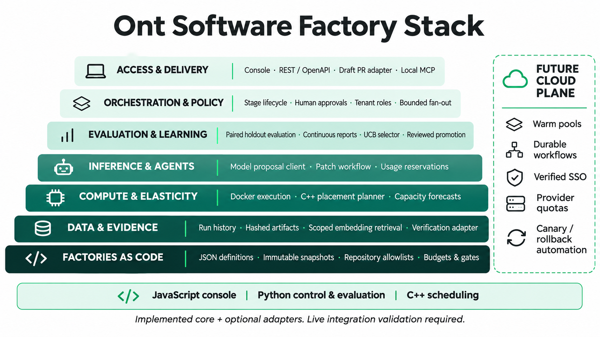

Introducing Ont

# Software, infrastructure, and continuous learning.

Ont is an AI engineering platform for building, operating, and improving software and infrastructure.

By Bijit Ghosh • Open source · MIT license

Engineering with AI takes more than generating code. A useful change needs context, an execution environment, verification, a review decision, and a delivery path. Ont connects those responsibilities through a configurable control plane, giving teams a clear view of what agents are doing and why.

**Human judgment. Agent execution. Continuous learning.** People define the outcome and approve consequential decisions. Agents perform bounded work. Evidence from that work helps improve the next iteration.

## Factory execution, workshop craftsmanship

Ont combines repeatable automation with room for engineering judgment. Its factory approach organizes routine execution; its workshop approach helps people explore alternatives, inspect results, and build more ambitious systems. The aim is to protect human attention for architecture, quality, and decisions that matter.

## Five product capabilities

1. **Define the work.** Configure repositories, budgets, stages, and review gates in versioned factory definitions. Every work order retains its own snapshot, so later policy edits do not silently change work already underway.

2. **Control execution.** Workers use explicit claims, heartbeats, and leases. Docker execution and verification adapters bound the runtime; a Rust planner provides resource-fit selection and capacity recommendations.

3. **Keep context and evidence together.** The console connects briefs, activity, artifacts, and approvals. Persistent run history, content hashes, and scoped embedding retrieval support inspection and review.

4. **Verify and deliver.** Optional adapters cover immutable repository checkout, allowed-path patches, container checks, draft pull requests, and allowlisted Kubernetes rollout and undo. Delivery checks bind verification to the exact commit.

5. **Improve from measured outcomes.** Compare candidate configurations against a baseline on held-out tasks, including quality and cost. Safety and regression gates determine whether a change merits human review.

## A layered architecture



*Seven layers connect engineering policy, execution, evidence, and improvement.*

| Layer | Role in Ont |
| --- | --- |
| Factories as code | Definitions, configuration snapshots, repository policy, budgets and gates |
| Data & evidence | Run history, artifacts, scoped context and verification records |
| Compute & elasticity | Execution environments, Rust placement and bounded capacity planning |
| Inference & agents | Model proposal clients, harness interfaces and patch workflows |
| Evaluation & learning | Paired comparisons, continuous reports and policy-selection experiments |
| Orchestration & policy | Stage progression, leases, approvals, roles and bounded fan-out |
| Access & delivery | Console, REST/OpenAPI, local MCP discovery and delivery adapters |

JavaScript powers the browser console. Python implements workflow control, evaluation, and integration adapters. Rust handles native planning. The current deployment persists records in SQLite; the cloud design separates durable orchestration, storage, inference, and execution as deployment needs grow.

## From request to reviewed change

Work order → configuration snapshot → leased stage → execution → evidence → approval → delivery

The control plane manages workflow state and review gates. Configured worker and delivery adapters connect that state to repositories and deployment targets. This keeps the model, execution environment, and delivery provider replaceable without making any one of them the owner of engineering policy.

## Infrastructure is part of the work

Software depends on environments, compute, permissions, and release pipelines. Ont includes explicit interfaces for those concerns, with role boundaries, repository allowlists, resource controls, and accountable usage. Its architecture extends from code changes to the infrastructure that supports them.

The release provides the control plane and optional adapters; live providers and deployment targets need configuration and service-level validation. Warm sandbox pools, a connected elastic broker, verified SSO, and provider-enforced quotas are part of the roadmap.

## Continuous learning with review

A dataset watcher produces content-addressed comparison reports. A UCB policy-selection primitive supports configuration experiments, while held-out quality and safety gates control review eligibility. Ont uses verified outcomes to guide improvements; it does not equate an agent's own success message with independent evidence. Model-weight training and automatic production promotion remain future integrations.

## Try Ont

Ont is open source under the MIT license. Its release checks cover Python workflows, frontend logic, Rust tests, package installation, and Docker HTTP/restart behavior. The [test summary](https://github.com/bijit-ghosh/Ont/blob/main/docs/TEST_SUMMARY.md) distinguishes passed checks from blocked and pending validation.

```bash
git clone https://github.com/bijit-ghosh/Ont.git
cd Ont
python -m venv .venv
. .venv/bin/activate
python -m pip install -r requirements.lock.txt
python -m pip install --no-deps .
ont demo
```

Use Python 3.12 or later. On Windows PowerShell, activate with `.\.venv\Scripts\Activate.ps1`. Open `http://127.0.0.1:3000` on the machine running Ont. Demo orders are labeled and use illustrative artifacts; connect a configured worker and provider for real execution.

[Explore the repository](https://github.com/bijit-ghosh/Ont) · [Read the architecture](https://github.com/bijit-ghosh/Ont/blob/main/docs/FACTORY_STACK.md) · [Review validation](https://github.com/bijit-ghosh/Ont/blob/main/docs/TEST_SUMMARY.md)

Ont's direction is to make engineering more ambitious and more accountable: automate repeatable work, preserve human control, and use evidence to improve what comes next.
